# Preparing a shipment customer-support pilot

We can now prepare source extracts, map their fields, check evidence gaps, and run the same evaluator used for the synthetic demonstration. The actual systems, access permissions, workflow rules, and logging completeness still need an authorized sample from the company.

```mermaid
flowchart LR
    A[CRM, tracking, agent and finance sources] --> B[Read-only extraction or company-provided files]
    B --> C[Preserved local source snapshot]
    C --> D[Versioned field mapping]
    D --> E[Evidence and linkage checks]
    E --> F[Normalized exports]
    F --> G[Enquiry verification at the observation time]
    G --> H[Service, human work and scoped costs]
    H --> I[Deployment or upgrade comparison]
    I --> J[Traceable reports and explicit gaps]
```

## What is implemented

| Capability | How it is used |
| --- | --- |
| CSV, JSON and JSONL preparation | A mapping profile states which source field supplies each evaluator field. Nested JSON records and tool-call lists are supported. |
| Read-only JSON API collection | The configurable collector fetches pages, retries transient failures, respects rate-limit delays, and publishes a local snapshot after the configured extraction completes. Its tests use mocked endpoints. |
| File import and approval | Open **Prepare company files**, preview and review the original records, inspect any trial mapping, and select **Approve for evaluation**. The evaluator checks the approval and file fingerprints before using the reviewed company extract. |
| Reusable mapping example | **Preview synthetic company extract** demonstrates the complete import on renamed copies of S32's records. |
| Evidence readiness | **Data readiness** reports what the records can support, missing fields, timestamp interpretation, broken links, allocation coverage and incomplete histories. |
| Completeness declarations | Company imports start with source coverage unknown. A source owner can declare complete or partial coverage for a specified extraction. Unverified history cannot establish the first answer, zero human work or an omitted action. |
| Traceability | Published imports preserve the original files, profile, file hashes and row references. The evaluator only reads the normalized `exports` directory. |
| Asynchronous delivery links | A response can name its agent run explicitly, or a run can name its delivered response. Matching also checks the actor, text and successful send action. |
| Workflow settings | A company grading policy can be selected before evaluation. Service thresholds and request profiles are versioned with each analysis. |
| Repeatable local results | An identical input and configuration produces the same calculated result. Imports and run bundles are published atomically. |

Under **Data readiness → Data quality and records to review**, the affected share divides unique affected rows by delivered export rows, overall and by file. Identical extra copies count as affected rows but not as extra service activity. A conflicting ID counts once in the ID column, while each supplied version is listed at its row location. Issue counts can overlap. Missing or unreadable files have no row denominator. Completeness of the original systems is a separate question.

For prepared imports, the original-source mapping table uses its own denominator and lists rejected or unconvertible records separately. The issue browser links to the export and, where the mapping can be aligned, the original source location. Filter by file, issue, record or enquiry and download the full register as CSV. A disputed enquiry can be absent from the comparison population and still appear here. If a conflict or rejected record could affect eligibility or a critical service check, the dashboard requires review before it can suggest expansion. A disputed active-work total does not invalidate a separately proven service failure.

## Which data to request

Start with a small authorized, consistently pseudonymized sample that includes successful cases, handoffs, corrections and unresolved work. Include related tables over the same period and confirm the last time covered by the extracts. Count the selected requests in the source system so we can reconcile the extracted population.

| Owner | Records and definitions to confirm | What they allow us to check |
| --- | --- | --- |
| Customer support or CRM | Intake message, customer/account key, conversation and case IDs, sent replies, updates, reopenings, closure reason and follow-up links | What the customer asked, what was delivered, and whether the case was resolved |
| Tracking or operations | Booking and container IDs, destination and milestone, planned/estimated/actual classification, event time and publication time, revisions and holds | What information was available when a reply was sent |
| AI or integration team | Version/model, run and response IDs, tool input/output and success, actual send acknowledgement, handoff, usage, retries and failures | Which agent acted and which backend operation completed |
| Workforce management | Active work durations, timing method, pauses, concurrent work and after-contact work | Remaining human effort and capacity released |
| Finance | Billing units and rates by effective period/model, invoices and credits, maintenance/setup scope, labour cost and currency | Reconciled costs and a defensible economic boundary |
| Experiment or rollout owner | Allocation recorded before handling, introduction dates, eligibility and regional rules | Whether a comparison can estimate incremental contribution |

To verify routing, request a case-history event that identifies the destination queue or team. Map the carrier's queue names to the agreed Operations label. A generic escalation status leaves the destination unconfirmed.

### Measuring employee effort

In the first authorized sample, we will compare three records for the same enquiry: the CRM case and replies, any contact or work-session logs, and a small sample of directly timed work. We will check the timing definition with the source owner before mapping a duration to `active_seconds`. Ticket opening and closure establish elapsed time. They leave effort unknown.

| Potential source | What we would verify before using it |
| --- | --- |
| CRM work timer | Salesforce Omni-Channel Active Time is based on console tabs and can keep running while the employee uses another browser tab or window. The Zendesk Time Tracking app records time on ticket updates and supports pausing. Check timer configuration, manual edits, history and work in carrier portals. [Salesforce](https://help.salesforce.com/s/articleView?id=000382097&language=en_US&type=1), [Zendesk](https://support.zendesk.com/hc/en-us/articles/4408822487450-Using-the-Time-Tracking-app) |
| Contact center records | Amazon Connect records interaction, hold and wrap-up durations. Link call legs or chat sessions to the enquiry, check concurrent contacts and preserve hold separately until we know how it was used. [Contact records](https://docs.aws.amazon.com/connect/latest/adminguide/ctr-data-model.html), [routing and concurrency](https://docs.aws.amazon.com/connect/latest/adminguide/routing-profiles.html) |
| Representative time study | If routine logs are insufficient, time a sample of ordinary cases and AI handoffs or corrections under the same rules. Record breaks, switches, offline work and after-contact work. Show the sample size, coverage and uncertainty when applying a group estimate. [UK Treasury service-costing guidance](https://www.gov.uk/government/publications/service-costing-in-government/service-costing-in-government) |

Ask for the work event ID, enquiry or case ID, a consistent pseudonymous employee ID, channel, timestamps with offsets, observed seconds, measurement method and the source's definitions for pauses, overlap and wrap-up. Check whether the logged duration already includes after-contact work. Count each worker's overlapping clock time once only when the source can establish its allocation. Leave unresolved overlaps outside the measured total. Work by two different employees can contribute both employees' effort.

Rows labelled `estimated`, elapsed-time proxies and undocumented methods remain available for review. They leave measured effort and the affected labour cost incomplete. We can still verify the response, human correction and resolution from their own records. A time study could support a separately labelled capacity estimate. Actual payroll, overtime or vendor spend and a credible comparison are needed for a cash-savings claim. Synthetic active-work rows test what the evaluator does when time is observable. The tests also cover absent work logs, estimates and elapsed-time proxies without requiring the pilot to supply a precise duration for every case.

## Real-world problems and how we handle them

| Problem | Treatment in the prepared system or pilot task |
| --- | --- |
| Different names, formats or enum values | Change the mapping profile. Preserve the source record and conversion history. |
| Missing optional table | Inspect supported service results and report the affected capability as partial or unavailable. |
| Duplicates or conflicting IDs | Preserve the evidence and flag conflicts. Exact duplicates count once in the evaluator. |
| Missing offset or ambiguous local time | Require the original offset or an explicit source zone. Leave ambiguous measurements unverified. |
| Only the current tracking snapshot is retained | Historical answer accuracy remains unknown until publication history or an equivalent trusted snapshot is available. |
| The export contains an internal ETA without a sent ETA | For company and unlabeled exports, review the customer reply or transcript. An internal timestamp alone leaves the requested ETA unverified. |
| Different IDs across systems | Agree a customer/case/booking/container mapping from source evidence and check join coverage. Avoid guessing the correct booking from the desired answer. |
| Sampled traces or omitted failures | Mark source coverage partial. An empty log is insufficient to infer zero work or success. |
| Ticket elapsed time supplied without active work | Show elapsed service time and request a validated timer or representative time study for effort. |
| No recorded treatment assignment | Verify individual cases. Describe group differences with a study-design limitation. |
| Asynchronous run and response times | Use a source-provided response/run relationship. The adapter must preserve generation, send and record times separately. |
| Free text or language beyond the reviewed wording | Retain the text and an interpretation gap. Validate extraction with independent reviewers before expanding automatic judgments. |
| Late invoices, credits or several model prices | Reconcile the applicable period and model-specific quantities. The current scoped ledger needs a further model/rate mapping for several prices under the same monthly category. |
| Truck, warehouse or demurrage losses | Collect shipment-linked actions and final charge/credit records. These downstream effects are outside the current resource-cost ledger. |

## Source extraction contract

For an API, document the read-only endpoint, account scope, selected fields, response envelope, pagination stop condition, time filters, deletion/history behavior and rate limits. Credentials belong in the company's approved secret storage or local environment. Keep them out of mapping profiles and saved manifests.

An extraction is a snapshot with an explicit period and completion record. Publish it after all selected pages are fetched successfully. On a failed page, retry the extraction without marking that period complete. Retaining stable IDs allows duplicate delivery or overlapping extraction windows to be checked during preparation. Provider-specific deletion and revision rules require source validation.

The [collector configuration](acquisition/README.md) supports explicit next-page URLs or offset rules, query filters, bounded retries, and credentials from an environment variable. Its sample uses `example.invalid` and is validated without making requests. A completed fetch still needs source-owner confirmation that permissions, period, retained fields and historical data are adequate.

For exported logs, document whether they include all attempts, retries, failed actions and customer-visible sends. A tool-call trace can show a request to create a case. The case system must establish whether the case exists and when its state changed. The supporting [source research](docs/PILOT_DATA_SOURCES.md) records the public API and logging constraints.

## What we adjust with the pilot company

1. Confirm the specific service workflow, intended business outcome, data owner and access scope.
2. Reconcile source counts and field meanings on a small sample. Configure source mapping, time zones and extraction completion declarations.
3. Have workflow reviewers judge selected cases independently. Compare identity, timing, actions, outcome and unknown judgments against the evaluator.
4. Resolve material mapping or interpretation errors and freeze the resulting policy and evaluator version.
5. Validate a comparison design with adequate follow-up. Run the pilot and record scope and uncertainty.

Independent held-out scoring remains a separate evaluation step. Real agents can generate new trials in a controlled environment once the replay runner and model access are implemented. The prepared import path can receive those resulting operational records.

## Current limits

This is a local application. Remote multi-user hosting, authentication and company retention controls require a deployment decision. No company endpoint, sample, field mapping or policy has been confirmed. Carrier-specific API behavior, deletion history, transcript extraction and financial effects will be validated against the records the company supplies. The preparation checks describe available evidence and do not certify real-world evaluator accuracy.
